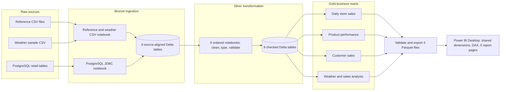

# Retail Lakehouse: PostgreSQL, Spark, Delta Lake, Airflow, and Power BI

An end-to-end local data engineering project. PostgreSQL tables, reference CSV files, and weather observations flow through Bronze, Silver, and Gold Delta tables. Apache Airflow runs the notebooks in order and exports checked Gold snapshots for a five-page Power BI report.

## Workflow at a glance

The diagram shows how data moves. The [Airflow DAG](airflow/dags/retail_lakehouse.py) runs the work **sequentially** in 17 tasks:
`check_project` -> Bronze CSV -> Bronze PostgreSQL -> Silver notebooks 01-09 -> Gold notebooks 01-04 -> Power BI Parquet export.
Each notebook must succeed before the next starts. The export reopens each Parquet file and checks its schema, row count, and revenue against the Gold Delta source.

The DAG uses `schedule=None`: trigger it manually after updating source data. It does not watch for new files. After the export succeeds, use **Refresh** in Power BI Desktop to load the new data; the DAG does not refresh Power BI itself. One active DAG run is allowed at a time.

## What the layers do

| Layer | Work | Output |
| --- | --- | --- |
| Bronze | Ingest PostgreSQL tables through JDBC and load reference and weather CSV files; check source counts and schemas. | Source-aligned Delta tables |
| Silver | Type, clean, validate, and relate customers, suppliers, products, stores, promotions, weather, orders, order items, and payments. | Nine checked Delta tables |
| Gold | Build daily store sales, product performance, customer sales, and weather-sales analysis at explicit grains. | Four reconciled Delta marts |
| Export | Read approved Gold tables, validate row counts and totals, and write Parquet snapshots. | Power BI import files |
| Report | Model shared Date and Store dimensions, DAX measures, slicers, and five pages. | [Power BI report](powerbi/Dashbords.pbix) |

The completed-order sales definition is **subtotal minus discount, before tax**. Estimated gross profit is that net revenue minus estimated product cost. Cancelled and returned orders are excluded from sales. Product discounts are allocated to order lines with a rounding reconciliation. Weather comparisons describe associations, not causal effects. See [Gold metric notes](lakehouse/gold/GOLD_NOTES.md) and the [report blueprint](powerbi/REPORT_BLUEPRINT.md).

## Validated training snapshot

| Check | Result |
| --- | ---: |
| Source orders | 4,000 |
| Completed orders | 3,665 |
| Completed units | 13,628 |
| Net revenue | PKR 12,824,593.40 |
| Estimated gross profit | PKR 3,489,436.22 |
| Daily store rows | 552 |
| Product-performance rows | 8,417 |
| Customers | 750, including 9 without a completed sale |

Gold marts reconcile to the same completed-order totals. The report must not add revenue from different marts together because they represent the same sales at different grains.

## Repository map

- [`ingestion/`](ingestion/) - PostgreSQL table definitions and database inspection notebooks.
- [`lakehouse/bronze/`](lakehouse/bronze/) - source ingestion and verification.
- [`lakehouse/silver/`](lakehouse/silver/) - typed and validated entities.
- [`lakehouse/gold/`](lakehouse/gold/) - business marts and reconciliation.
- [`airflow/dags/retail_lakehouse.py`](airflow/dags/retail_lakehouse.py) - manual end-to-end orchestration.
- [`powerbi/01_export_gold_parquet.ipynb`](powerbi/01_export_gold_parquet.ipynb) - checked Parquet export.
- [`powerbi/Dashbords.pbix`](powerbi/Dashbords.pbix) - five-page Power BI Desktop report.

## Local setup and run

This is a learning project built on Windows with Ubuntu/WSL2, Docker Desktop, Python 3.12, PySpark/Delta Lake, Jupyter, and Apache Airflow 3.3.2. The checked-in DAG uses the local path `/mnt/f/Big Data/Retail_Lakehouse_Learning` and a Jupyter kernel named `retail-lakehouse-wsl`; change these for another machine. The PostgreSQL notebook expects Docker's port `127.0.0.1:5433`.

1. Copy `.env.example` to a local `.env` and choose a password. Start the PostgreSQL service with `docker compose up -d postgres`.
2. Prepare the CSV and PostgreSQL source data. The supplied training files and generated landing data are not included in this public repo.
3. Set up a Spark-capable Python environment and register the `retail-lakehouse-wsl` Jupyter kernel. Update notebook project paths if the checkout location differs.
4. Install Airflow in a separate Python environment, copy the DAG to `$AIRFLOW_HOME/dags/`, and start Airflow. Trigger `retail_lakehouse` manually.
5. Check that all 17 tasks succeed. Open the PBIX in Power BI Desktop and use **Refresh** after the Parquet export. A clone cannot refresh until its source data and paths are configured.

The raw data, `.env`, generated Delta tables, Parquet exports, and Airflow run artifacts are intentionally excluded from Git. The PBIX contains a demonstration data snapshot and is included to show the finished report.
